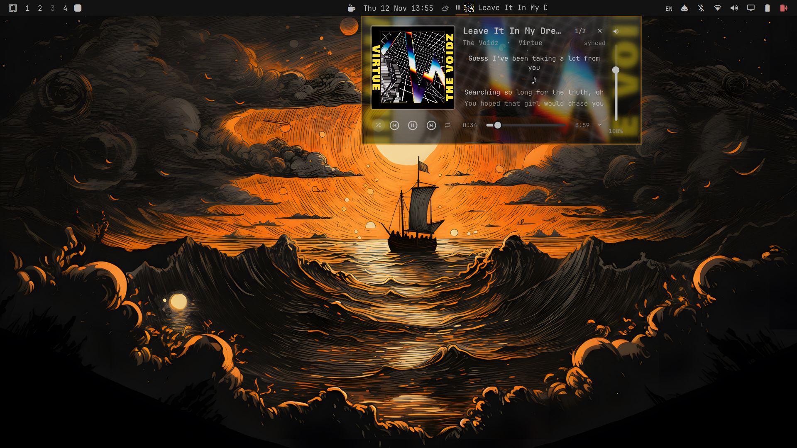

# Liquid Media

[](https://github.com/Tarik-Lotfy/omarchy-liquid-media/actions/workflows/validate.yml)
[](https://github.com/Tarik-Lotfy/omarchy-liquid-media/releases)
[](LICENSE)

A liquid-glass now-playing popup for the Omarchy bar. It clones the stock media
widget and replaces it in place, adding synced lyrics, playback controls, and
per-song volume to a compact, pinned player.


## Features

**Playback**

- Previous, play/pause, and next.
- Shuffle and repeat, disabled automatically when the player does not expose the
  matching MPRIS properties.
- Seek bar with elapsed and total time.
- Multi-player switching: a compact `N/M` badge cycles sources from the bar, and
  the expanded popup lists every player.
- Per-song volume through the player's own PipeWire stream, falling back to
  MPRIS volume.

**Lyrics**

- Synced lyrics from [LRCLIB](https://lrclib.net), with plain-text
  [Genius](https://genius.com) lyrics as a fallback.
- Apple Music–style active-line highlighting and smooth scrolling.
- Lookups are cached for the session, so reopening the popup does not repeat
  searches.

**Bar widget**

- Album thumbnail, title marquee, and a hairline progress line.
- Seamless looping title for long tracks, and elapsed/total time on hover.
- Right-click to play or pause without opening the popup.

**Layout**

- Compact and expanded popups, with the choice saved across shell restarts.
- The expanded layout adds larger art, a bigger transport row, and the full
  source list.

## Compact and expanded

| Compact | Expanded |
| --- | --- |
|  |  |

The expand button at the bottom-right of the popup toggles between the two
sizes. The close button sits at the top-right of the title row.

## Requirements

- Omarchy Quattro (4.0.6 or newer) with the Quickshell shell.
- `curl` and `jq` (both ship with Omarchy).
- PipeWire for per-song volume control.
- Network access for lyric lookups.

No API keys are required.

## Install

```bash
omarchy plugin add https://github.com/Tarik-Lotfy/omarchy-liquid-media.git --enable
```

The plugin declares `clonedFrom: omarchy.media`, so enabling it replaces the
built-in media widget in its existing bar slot and disables the built-in copy.
If you install without `--enable`, enable it manually:

```bash
omarchy plugin enable io.github.tarik-lotfy.liquid-media --section right
```

## Usage

| Action | Result |
| --- | --- |
| Left-click | Open or close the popup |
| Right-click | Play or pause |
| Middle-click | Next track |
| Scroll up / down | Previous / next track |
| Hover | Track, artist, and elapsed/total time |

Inside the popup:

- The `N/M` badge cycles sources in compact mode; the expanded layout lists them.
- Shuffle and repeat dim when the active player does not expose those MPRIS
  properties (Firefox, for example, has no `Shuffle`).
- The title marquee loops seamlessly and pauses while the popup is open.

## Scripting

The plugin exposes an IPC target for keybindings and scripts:

| Command | Result |
| --- | --- |
| `omarchy-shell liquid-media toggle` | Open or close |
| `omarchy-shell liquid-media open` | Open |
| `omarchy-shell liquid-media close` | Close |
| `omarchy-shell liquid-media toggleSize` | Compact or expanded |
| `omarchy-shell liquid-media expand` | Expanded layout |
| `omarchy-shell liquid-media collapse` | Compact layout |
| `omarchy-shell liquid-media shuffle` | Toggle shuffle |
| `omarchy-shell liquid-media loop` | Off → all → one → off |
| `omarchy-shell liquid-media source` | Switch to the next player |
| `omarchy-shell liquid-media status` | JSON state for scripts |

Example Hyprland binding:

```conf
bind = SUPER, M, exec, omarchy-shell liquid-media toggle
```

## Troubleshooting

- **The popup does not appear.** Confirm the plugin is enabled with
  `omarchy plugin list` and that a player is visible on D-Bus:
  `busctl --user list | grep org.mpris.MediaPlayer2`.
- **No lyrics.** Lyrics need network access. Instrumental or very new tracks may
  not be indexed yet; the popup falls back to plain Genius text, then to a
  "no lyrics" message.
- **Shuffle or repeat is greyed out.** The active player does not expose those
  MPRIS properties. Switch players with the `N/M` badge.
- **Volume does nothing.** Per-song volume needs the player's PipeWire stream. If
  the stream is not visible, the plugin falls back to the player's MPRIS volume.
- **The popup is in the wrong place after changing bar settings.** Restart the
  shell with `omarchy-restart-shell`.

## Privacy

Lyric lookup sends the current track title and artist to `lrclib.net`. If LRCLIB
has no match, the title and artist are sent to `genius.com`. No listening history
is stored by this plugin; the lyrics cache lives in memory for the current shell
session only.

## Notes

- Spotify does not publish MPRIS position updates while playing, so the popup
  keeps a local clock and resynchronizes it from D-Bus while open.
- Per-song volume uses the player's PipeWire playback stream, so it does not
  change the system output volume.
- The plugin is a modified copy of Omarchy's built-in `omarchy.media` plugin.
  See [LICENSE](LICENSE) for MIT attribution.

## Remove

```bash
omarchy plugin remove io.github.tarik-lotfy.liquid-media
```

Removing the clone restores the built-in `omarchy.media` widget.

## License

MIT. Derived from Omarchy's `omarchy.media` plugin.
